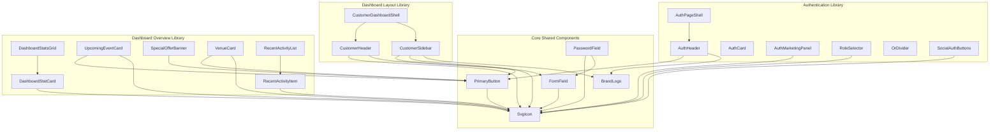

# Component Architecture & Design System Report: Manadabam (ES EMS)

## 1. Executive Summary

This architecture report provides a complete component blueprint for the **Manadabam** event management platform based on direct Figma MCP extraction from the **"ES EMS"** design document (`fileKey: JrbJcgDfskzFiqhKfUCuvA`, canvas `62:2156`).

The platform comprises three core user journeys analyzed in this phase:
1. **Login** (`62:2157`, `1512px × 1019px`)
2. **Sign Up** (`62:2353`, `1512px × 1217px`)
3. **Customer Dashboard** (`62:2596`, `1440px × 1177px`)

Rather than developing monolithic, page-isolated codebases, this report establishes a modular, type-safe **Shared Component Library** built with **Next.js 16 (App Router)**, **React 19**, **TypeScript**, and **Material UI (MUI)**. This architecture enforces single-responsibility components, strict prop contracts, tokenized theme styling, zero ad-hoc icon library dependencies, and clean separation between reusable presentation components and eventual page compositions.

---

## 2. Analysis of the Login Screen (`62:2157`)

### 2.1 Viewport & Layout Hierarchy
* **Dimensions**: `1512px` width by `1019px` height.
* **Canvas Style**: Soft multi-stop radial gradients overlaid on `#F7F9FC` with a white base.
* **Layout Structure**:
  * **Top Navigation Bar (`#62:2345`)**: Floating white pill container (`1394px × 80px`, radius `16px`, padding `16px 56px`) with the brand logo (`image 348`: *ES EthicSecur SofTec (P) Ltd*) on the left and a switch action (*"Don't have an account?"* + *"Sign Up"* button link) on the right.
  * **Main Content Area (`#62:2158`)**: 12-column grid layout (`1394px` wide, gap `56px`) divided into:
    * **Left Column (Marketing & Showcase, 5 columns / 634px)**:
      * Subheading tracker: `"PLAN · BOOK · CELEBRATE"` (13px Bold, uppercase, letter-spacing `0.1em`, color `#64748B`).
      * Main headline: `"Your Perfect Event Starts Here"` (54px ExtraBold `#020617`, with *"Starts Here"* accented in brand blue `#1359FA`).
      * Description text: 18px regular text (`#475569`, line-height `28px`).
      * 2×2 Feature Grid: *Verified Venues*, *Trusted Vendors*, *Event Packages*, *Secure Payments* (each with icon pill, title, and descriptive label).
      * Layered Visual Collage: Illuminated marquee tent image, luxury ballroom inset, sunset reception inset, decorative sparkle SVG, and floating pill badges (*"500+ Premium Venues"*, *"★ 4.8 Customer Rating"*).
    * **Right Column (Login Experience Card, 5 columns / 722px)**:
      * White card (`#FFFFFF`, radius `24px`, border `rgba(241, 245, 249, 0.9)`, subtle elevation shadow).
      * Header: `"Welcome Back"` (40px ExtraBold `#0F172A`) + subtitle *"Log in to your EthicSecur account"*.
      * 4-Way Segmented Tab Role Selector: **Customer** (active), **Venue Owner**, **Service Vendor**, **Admin** (52px height, radius `16px`, background `#F8FAFC`).
      * Form Controls:
        * *Email or Phone Number* input (56px height, radius `16px`, border `#E2E8F0`, leading mail icon).
        * *Password* input (56px height, radius `16px`, leading lock icon, trailing eye visibility toggle, right-aligned *"Forgot Password?"* link).
        * *Remember me* checkbox (custom 18px checkbox, label in `#334155`).
        * *Log In* primary submit button (56px height, background `#1359FA`, radius `8px`, white bold text + arrow SVG icon).
      * Horizontal divider with centered `"OR"` pill.
      * Social auth buttons: *"Continue with Google"* and *"Continue with Apple"* (bordered pills, radius `8px`).
      * Legal disclaimer footer: *"By continuing, you agree to our Terms of Service and Privacy Policy."*
  * **Page Footer**: Center-aligned copyright notice: *"© 2025 EthicSecur Events Inc. All rights reserved."*

---

## 3. Analysis of the Sign Up Screen (`62:2353`)

### 3.1 Viewport & Layout Hierarchy
* **Dimensions**: `1512px` width by `1217px` height.
* **Shared Patterns with Login**:
  * Identical top navigation bar structure (`1394px × 80px`), but the right action switches to: *"Already have an account?"* + *"Log In"* button.
  * Identical background radial gradient styling.
  * Identical left marketing column (634px) with `"PLAN · BOOK · CELEBRATE"`, headline, 2×2 feature grid, image collage, and floating promotional badges.
  * Identical 4-way role switcher (**Customer**, **Venue Owner**, **Service Vendor**, **Admin**).
  * Identical `"OR"` divider and Social Authentication buttons (Google, Apple).
  * Identical copyright footer.
* **Differences / Sign Up Specifics**:
  * Card title: `"Create Your Account"` (40px ExtraBold) + subtitle *"Join EthicSecur Events and start planning your perfect event"*.
  * Additional & modified form fields:
    * *Full Name* input (user icon).
    * *2-Column Row*: *Email Address* (left) + *Phone Number* (right, with `+91` country code selector badge and vertical border).
    * *Password* input (lock icon + eye toggle).
    * *Confirm Password* input (lock icon + eye toggle).
    * *Terms Agreement Checkbox*: *"I agree to the Terms of Service and Privacy Policy."*
    * Submit button: *"Create Account"* (56px height, background `#1359FA`, white bold text + arrow icon).
  * Card height expands to `978px` to accommodate the 2-column inputs and confirm password field.

---

## 4. Analysis of the Customer Dashboard (`62:2596`)

### 4.1 Viewport & Shell Layout
* **Dimensions**: `1440px` width by `1177px` height.
* **Layout Structure**: Two-column app shell:
  * **Left Sidebar Navigation (`#62:2597`)**: Fixed `256px` width, background `#FFFFFF`, border-right `1px solid #E2E8F0`:
    * Brand Logo header: `166px × 36px`.
    * Main navigation group: *Dashboard* (active, `#EFF6FF` pill, `#2563EB` text), *Discover*, *Venues*, *Event Services*, *Packages*.
    * Manage / Events group: *My Events*, *Bookings*, *Payments*, *Invoices*, *Favorites*, *Messages*, *Notifications*.
    * Account Settings group: *Profile*, *Settings*, *Help & Support*.
    * Promotional Support Card (`#62:2710`): Inset gradient card with support consultant avatar (`image 352`), title *"Need Help Planning Your Event?"*, subtitle, and *"Contact Expert"* button.
  * **Top Header Bar (`#62:2729`)**: `80px` height, white background, border-bottom `1px solid #E2E8F0`, padding `0 32px`:
    * Global Search Field: Pill input with search SVG icon, placeholder *"Search venues, services, or packages..."*.
    * Action badges: Favorites button (badge count `3`), Notifications button (badge count `5`).
    * User Profile Dropdown: User avatar (`323d38aa...`), Name: *"USER"*, Role tag: *"Customer"*, chevron icon.
  * **Dashboard Body Workspace (`#62:2762`, padding: 24px, gap: 24px)**:
    1. **Greeting Row**: *"Good Morning, USER! 👋"* + *"Plan New Event"* CTA button (`#2563EB`, plus/calendar icon).
    2. **4 Key Metric Cards Row (`#62:2778`)**:
       * *Upcoming Events*: Value `2`, change badge `↑ 1 this month`, blue theme (`#F1F8FE`).
       * *Active Bookings*: Value `3`, status badge `2 confirmed` with green dot, green theme (`#EFF9F4`).
       * *Total Spent*: Value `₹2,85,000`, change badge `This year ↑ 18%`, orange theme (`#FDF4ED`).
       * *Saved Venues*: Value `8`, favorite label with heart icon, purple theme (`#F5F3FE`).
    3. **Middle Section Grid (`#62:2847`)**:
       * *Main — Upcoming Event Module (9 cols)*: Image decor (`image 349`), "Confirmed" status badge, tags (*"Wedding"*, *"Main Event"*), title *"Wedding Celebration"*, location (*"ABC Convention Hall, Chennai"*), date (*"20 Dec 2026"*), guest count (*"500 Guests"*), advance paid / remaining balance summary, and action buttons (*"View Event Details"*, *"Manage Booking"*).
       * *Right — Special Offer Banner (3 cols)*: Dark photo card with gradient overlay, *"SPECIAL OFFER"* tag, *"Premium Wedding Packages"* title, price info, and *"Explore Packages"* button.
    4. **Bottom Section Grid (`#62:2938`)**:
       * *Recommended for You (8 cols)*: Section tabs (*Venues*, *Event Services*, *Packages*) + 4 Venue Cards row:
         * Venue 1: *ABC Convention Hall* (₹1,20,000, 500-1000 guests, ★ 4.8)
         * Venue 2: *Royal Wedding Palace* (₹95,000, 300-800 guests, ★ 4.7)
         * Venue 3: *Grand Lotus Banquet* (₹85,000, 300-600 guests, ★ 4.6)
       * *Recent Activity Feed (4 cols / 327px)*:
         * *Booking Confirmed* (#EVT-000145, 2 hours ago)
         * *Payment Successful* (₹1,00,000 completed)
         * *Vendor Confirmed* (Royal Decorators, 1 day ago)
         * *New Message* (ABC Convention Hall)
         * *Final Payment Reminder* (Due 15 Dec 2026, 2 days ago)

---

## 5. Reusable Components Shared Across All Screens

| Component Name | File Path | Responsibility | Figma Source Nodes |
| :--- | :--- | :--- | :--- |
| **`BrandLogo`** | `src/components/shared/BrandLogo.tsx` | Renders the primary brand mark (`/images/auth/logo.png`) with customizable dimensions, priority, and link destination. | `62:2346`, `62:2589`, `62:2600` |
| **`FormField`** | `src/components/shared/FormField.tsx` | Reusable text input field with floating/top labels, icon adornments, helper texts, and error handling. | `62:2279`, `62:2474`, `62:2484`, `62:2730` |
| **`PasswordField`** | `src/components/shared/PasswordField.tsx` | Specialized password input with lock icon, interactive eye/eye-off toggle, and optional "Forgot Password" link. | `62:2288`, `62:2509`, `62:2520` |
| **`PrimaryButton`** | `src/components/shared/PrimaryButton.tsx` | Primary brand CTA button with customizable variant, size, loading state, and arrow adornments. | `62:2308`, `62:2553`, `62:2771`, `62:2903` |
| **`SvgIcon`** | `src/components/shared/SvgIcon.tsx` | Zero-dependency inline SVG renderer for brand icons (mail, lock, eye, user, cellar, search, bell, heart, etc.). | `62:2257`, `62:2287`, `62:2740`, `62:2842` |

---

## 6. Authentication-Specific Reusable Components

| Component Name | File Path | Responsibility | Shared Between |
| :--- | :--- | :--- | :--- |
| **`AuthPageShell`** | `src/components/auth/AuthPageShell.tsx` | Outer page wrapper with background radial gradients, 12-column grid alignment, and copyright footer. | Login, Sign Up |
| **`AuthHeader`** | `src/components/auth/AuthHeader.tsx` | White rounded navigation header containing `BrandLogo` and switch-link action. | Login, Sign Up |
| **`AuthMarketingPanel`** | `src/components/auth/AuthMarketingPanel.tsx` | Marketing column featuring category tracker, bold headline, 2×2 feature grid, image collage, and rating badges. | Login, Sign Up |
| **`AuthCard`** | `src/components/auth/AuthCard.tsx` | Form card container (`722px` width, `24px` radius, elevation shadow) with title and subtitle headers. | Login, Sign Up |
| **`RoleSelector`** | `src/components/auth/RoleSelector.tsx` | Interactive 4-option segmented switcher (*Customer*, *Venue Owner*, *Service Vendor*, *Admin*). | Login, Sign Up |
| **`OrDivider`** | `src/components/auth/OrDivider.tsx` | Visual divider with horizontal rules and centered uppercase "OR" chip. | Login, Sign Up |
| **`SocialAuthButtons`** | `src/components/auth/SocialAuthButtons.tsx` | Side-by-side third-party authentication buttons (*Google* and *Apple*). | Login, Sign Up |

---

## 7. Dashboard-Specific Reusable Components

| Component Name | File Path | Responsibility | Reusability Scope |
| :--- | :--- | :--- | :--- |
| **`CustomerSidebar`** | `src/components/dashboard/layout/CustomerSidebar.tsx` | Fixed left navigation with brand logo, segmented links, and promotional support consultation card. | All customer dashboard views |
| **`CustomerHeader`** | `src/components/dashboard/layout/CustomerHeader.tsx` | Global top header with search input, notifications/favorites action buttons, and user profile trigger. | All customer dashboard views |
| **`CustomerDashboardShell`** | `src/components/dashboard/layout/CustomerDashboardShell.tsx` | App layout shell arranging sidebar, top header, and scrollable content canvas. | All customer dashboard views |
| **`DashboardStatCard`** | `src/components/dashboard/overview/DashboardStatCard.tsx` | Individual metric indicator with numeric value, label, contextual change badge, and color accent. | Overview, Analytics |
| **`DashboardStatsGrid`** | `src/components/dashboard/overview/DashboardStatsGrid.tsx` | Responsive 4-card grid container rendering metric summaries. | Overview, Analytics |
| **`UpcomingEventCard`** | `src/components/dashboard/overview/UpcomingEventCard.tsx` | Comprehensive event spotlight card with media, countdown/date, financial status, and booking actions. | Overview, Events page |
| **`SpecialOfferBanner`** | `src/components/dashboard/overview/SpecialOfferBanner.tsx` | Compact promotional banner featuring background imagery, gradient tint, value proposition, and CTA. | Overview, Packages page |
| **`VenueCard`** | `src/components/dashboard/overview/VenueCard.tsx` | Listing card for venues with photo, capacity, rating, pricing, and booking action. | Overview, Venue Discovery |
| **`RecentActivityItem`** | `src/components/dashboard/overview/RecentActivityItem.tsx` | Individual timeline activity item with status badge, title, timestamp, and message summary. | Overview, Notifications |
| **`RecentActivityList`** | `src/components/dashboard/overview/RecentActivityList.tsx` | Feed container for recent booking, payment, and message events. | Overview, Notifications |

---

## 8. Page-Specific Elements (Not in Component Library)

The following components are specific compositions and should be implemented by individual page developers in their assigned page files:
1. **`LoginForm`**: Specific form validation, state hooks for email/password, and submit handler logic for `/login`.
2. **`SignupForm`**: Specific form validation, 2-column layout arrangement for email/phone, confirm-password checking, and terms agreement validation for `/signup`.
3. **`CustomerDashboardHome`**: Top-level composition assembling the Greeting Row, Stats Grid, Upcoming Event module, Recommended Venues row, and Activity Feed for `/customer/dashboard`.

---

## 9. Component Dependency Diagram



---

## 10. Proposed Component Inventory & File Paths

```
src/
├── components/
│   ├── shared/
│   │   ├── BrandLogo.tsx
│   │   ├── FormField.tsx
│   │   ├── PasswordField.tsx
│   │   ├── PrimaryButton.tsx
│   │   └── SvgIcon.tsx
│   ├── auth/
│   │   ├── AuthPageShell.tsx
│   │   ├── AuthHeader.tsx
│   │   ├── AuthMarketingPanel.tsx
│   │   ├── AuthCard.tsx
│   │   ├── RoleSelector.tsx
│   │   ├── OrDivider.tsx
│   │   └── SocialAuthButtons.tsx
│   └── dashboard/
│       ├── layout/
│       │   ├── CustomerSidebar.tsx
│       │   ├── CustomerHeader.tsx
│       │   └── CustomerDashboardShell.tsx
│       └── overview/
│           ├── DashboardStatCard.tsx
│           ├── DashboardStatsGrid.tsx
│           ├── UpcomingEventCard.tsx
│           ├── SpecialOfferBanner.tsx
│           ├── VenueCard.tsx
│           ├── RecentActivityItem.tsx
│           └── RecentActivityList.tsx
├── types/
│   └── index.ts
└── theme/
    └── theme.ts
```

---

## 11. TypeScript Props & Component API Contracts

### 11.1 Authentication Types (`src/types/index.ts`)
```typescript
export type AuthRole = 'customer' | 'venue_owner' | 'service_vendor' | 'admin';

export interface RoleOption {
  id: AuthRole;
  label: string;
  iconName: string;
}

export interface AuthHeaderProps {
  switchText: string;
  actionText: string;
  actionHref: string;
}

export interface AuthMarketingFeature {
  title: string;
  description: string;
  iconName: string;
  badgeBg?: string;
}

export interface AuthMarketingPanelProps {
  categoryTracker?: string;
  headline?: string;
  headlineAccent?: string;
  subtitle?: string;
  features?: AuthMarketingFeature[];
  venuesCount?: string;
  ratingScore?: string;
}

export interface AuthCardProps {
  title: string;
  subtitle: string;
  children: React.ReactNode;
}

export interface RoleSelectorProps {
  selectedRole: AuthRole;
  onRoleChange: (role: AuthRole) => void;
  disabled?: boolean;
}

export interface SocialAuthButtonsProps {
  onGoogleClick?: () => void;
  onAppleClick?: () => void;
  loading?: boolean;
}
```

### 11.2 Dashboard Types (`src/types/index.ts`)
```typescript
export type StatTheme = 'blue' | 'green' | 'orange' | 'purple';

export interface DashboardStatItem {
  id: string;
  label: string;
  value: string | number;
  changeText?: string;
  changeType?: 'positive' | 'neutral' | 'info';
  iconName: string;
  colorTheme: StatTheme;
}

export interface UpcomingEventData {
  id: string;
  title: string;
  status: string;
  tags: string[];
  venueName: string;
  location: string;
  dateText: string;
  timeText: string;
  guestCountText: string;
  advancePaid: string;
  remainingBalance: string;
  imageUrl: string;
}

export interface VenueData {
  id: string;
  name: string;
  rating: number;
  reviewCount: number;
  capacityText: string;
  priceText: string;
  imageUrl: string;
  isFavorite?: boolean;
}

export type ActivityType = 'booking' | 'payment' | 'vendor' | 'message' | 'reminder';

export interface ActivityItemData {
  id: string;
  type: ActivityType;
  title: string;
  description: string;
  timestamp: string;
  isRead?: boolean;
}
```

---

## 12. Figma Asset Inventory

All assets have been exported directly from the live Figma document using `figma-developer-mcp`:

| Asset File | Target Project Path | Source Figma Node | Purpose |
| :--- | :--- | :--- | :--- |
| `logo.png` | `public/images/auth/logo.png` | `#62:2346` (`image 348`) | Main brand logo (Auth Header & Dashboard Sidebar) |
| `banquet_tent.png` | `public/images/auth/banquet_tent.png` | `#62:2214` | Marketing collage center showcase |
| `ballroom.png` | `public/images/auth/ballroom.png` | `#62:2227` | Marketing collage bottom-left showcase |
| `sunset.png` | `public/images/auth/sunset.png` | `#62:2229` | Marketing collage bottom-right showcase |
| `avatar.png` | `public/images/dashboard/avatar.png` | `#62:2752` | Top header user profile avatar |
| `consultant.png` | `public/images/dashboard/consultant.png` | `#62:2715` (`image 352`) | Sidebar support consultation card |
| `upcoming_event.png` | `public/images/dashboard/upcoming_event.png` | `#62:2913` (`image 349`) | Featured upcoming event decor photograph |
| `special_offer.png` | `public/images/dashboard/special_offer.png` | `#62:2924` (`image 350`) | Promotional banner backdrop photograph |
| `abc_convention.png` | `public/images/venues/abc_convention.png` | `#62:2960` | Recommended Venue 1 (ABC Convention Hall) |
| `royal_palace.png` | `public/images/venues/royal_palace.png` | `#62:2993` | Recommended Venue 2 (Royal Wedding Palace) |
| `grand_lotus.png` | `public/images/venues/grand_lotus.png` | `#62:3026` | Recommended Venue 3 (Grand Lotus Banquet) |

---

## 13. Design Tokens & MUI Theme Requirements

### 13.1 Typography
* **Font Family**: `Plus Jakarta Sans`, `-apple-system, BlinkMacSystemFont, "Segoe UI", Roboto, sans-serif`.
* **Weights**: Regular (400), Medium (500), SemiBold (600), Bold (700), ExtraBold (800).

### 13.2 Color Tokens
* **Primary / Brand Blue**: `#1359FA` (Main CTA, active highlights)
* **Secondary / Interactive Blue**: `#2563EB` (Icons, hover states)
* **Deep Blue Accents**: `#1A56DB`, `#0062FF`
* **Subtle Active Backgrounds**: `#EFF6FF`, `#EBF3FF`
* **Neutrals / Text**:
  * Heading 1 & Titles: `#020617`, `#0F172A`, `#1E293B`
  * Body & Labels: `#334155`, `#475569`
  * Muted / Placeholders: `#64748B`, `#94A3B8`
  * Borders & Dividers: `#E2E8F0`, `#F1F5F9`
  * Surface Backgrounds: `#FFFFFF`, `#F8FAFC`, `#F7F9FC`
* **Status Accents**:
  * Success / Emerald: `#059669`, `#10B981` (Surface: `#EFF9F4`, `#ECFDF5`)
  * Warning / Amber: `#F59E0B` (Surface: `#FFFBEB`, `#FEF3C7`)
  * Error / Rose: `#EF4444`, `#F43F5E` (Surface: `#FFF1F2`, `#FFE4E6`)

### 13.3 Elevation & Shadows
* **Card Elevation**: `0px 8px 16px -6px rgba(15, 23, 42, 0.03), 0px 20px 45px -10px rgba(15, 23, 42, 0.05)`
* **Subtle Border Shadow**: `0px 1px 2px 0px rgba(0, 0, 0, 0.05)`
* **Button Shadow**: `0px 2px 4px -2px rgba(19, 89, 250, 0.2), 0px 4px 6px -1px rgba(19, 89, 250, 0.2)`

---

## 14. Suggested Team Ownership

To prevent merge conflicts and ensure clear responsibilities, the following team assignments are established:

| Role | Developer | Scope of Work | Files to Implement |
| :--- | :--- | :--- | :--- |
| **Shared Core & Auth Components** | **Core Team / Completed in this task** | Shared library, theme tokens, assets, and component APIs | `src/components/shared/*`, `src/components/auth/*`, `src/components/dashboard/*`, `src/types/*`, `src/theme/*` |
| **Login Page Composition** | **Teammate A** | Compose Login view utilizing `AuthPageShell`, `AuthHeader`, `AuthMarketingPanel`, `AuthCard`, `RoleSelector`, `FormField`, `PasswordField`, `PrimaryButton`, `OrDivider`, `SocialAuthButtons` | `src/app/(auth)/login/page.tsx` |
| **Sign Up Page Composition** | **Teammate B** | Compose Sign Up view utilizing `AuthPageShell`, `AuthHeader`, `AuthMarketingPanel`, `AuthCard`, `RoleSelector`, `FormField` (2-col row), `PasswordField`, `PrimaryButton`, `OrDivider`, `SocialAuthButtons` | `src/app/(auth)/signup/page.tsx` |
| **Customer Dashboard Composition** | **Teammate C** | Compose Dashboard view utilizing `CustomerDashboardShell`, `CustomerSidebar`, `CustomerHeader`, `DashboardStatsGrid`, `UpcomingEventCard`, `SpecialOfferBanner`, `VenueCard`, `RecentActivityList` | `src/app/(workspace)/customer/dashboard/page.tsx` |

---

## 15. Component Integration & Usage Examples

### 15.1 Login Page Composition Pattern (Teammate A)
```tsx
import { AuthPageShell } from '@/components/auth/AuthPageShell';
import { AuthHeader } from '@/components/auth/AuthHeader';
import { AuthMarketingPanel } from '@/components/auth/AuthMarketingPanel';
import { AuthCard } from '@/components/auth/AuthCard';
import { RoleSelector } from '@/components/auth/RoleSelector';
import { FormField } from '@/components/shared/FormField';
import { PasswordField } from '@/components/shared/PasswordField';
import { PrimaryButton } from '@/components/shared/PrimaryButton';
import { OrDivider } from '@/components/auth/OrDivider';
import { SocialAuthButtons } from '@/components/auth/SocialAuthButtons';

export default function LoginPage() {
  return (
    <AuthPageShell
      header={
        <AuthHeader
          switchText="Don't have an account?"
          actionText="Sign Up"
          actionHref="/signup"
        />
      }
      marketingPanel={<AuthMarketingPanel />}
      authCard={
        <AuthCard
          title="Welcome Back"
          subtitle="Log in to your EthicSecur account"
        >
          {/* Teammate A wires state to RoleSelector, FormFields, and PrimaryButton */}
        </AuthCard>
      }
    />
  );
}
```

### 15.2 Customer Dashboard Composition Pattern (Teammate C)
```tsx
import { CustomerDashboardShell } from '@/components/dashboard/layout/CustomerDashboardShell';
import { CustomerSidebar } from '@/components/dashboard/layout/CustomerSidebar';
import { CustomerHeader } from '@/components/dashboard/layout/CustomerHeader';
import { DashboardStatsGrid } from '@/components/dashboard/overview/DashboardStatsGrid';
import { UpcomingEventCard } from '@/components/dashboard/overview/UpcomingEventCard';
import { SpecialOfferBanner } from '@/components/dashboard/overview/SpecialOfferBanner';
import { VenueCard } from '@/components/dashboard/overview/VenueCard';
import { RecentActivityList } from '@/components/dashboard/overview/RecentActivityList';

export default function CustomerDashboardPage() {
  return (
    <CustomerDashboardShell
      sidebar={<CustomerSidebar activePath="/dashboard" />}
      header={<CustomerHeader userName="USER" userRole="Customer" />}
    >
      {/* Teammate C wires StatsGrid, UpcomingEventCard, SpecialOfferBanner, VenueCards, RecentActivityList */}
    </CustomerDashboardShell>
  );
}
```

---

## 16. Validation Plan

1. **Static Analysis**: Run TypeScript compiler (`tsc --noEmit`) to verify zero prop mismatches or type errors.
2. **Lint Verification**: Run ESLint to ensure strict adherence to Next.js and React coding standards.
3. **Production Build**: Execute `npm run build` to validate server and client component boundaries.
4. **Asset Integrity Check**: Ensure all referenced images (`/images/...`) exist in the project and load without broken links.
5. **No Scope Creep**: Validate that neither the page composition files nor unauthorized third-party libraries were introduced.

---

## 17. Approved Icon Library Audit & Migration Summary

### 17.1 Approved Libraries
The platform strictly mandates only two approved icon sources:
1. **`reicon-react`** (`^1.2.6`)
2. **`@mui/icons-material`** (`^9.4.0`)

All custom SVG paths, manual `<path d="..." />` definitions, and direct SVG drawing functions have been completely eliminated from the codebase.

### 17.2 Icon Migration Mapping Table

| Component Name | Visual Concept | Original Source | Replacement Icon & Library |
| :--- | :--- | :--- | :--- |
| `RoleSelector`, `VenueCard`, `UpcomingEventCard`, `CustomerSidebar` | User Profile / Customer / Guest | Custom SVG `<path>` | `User` from `reicon-react` |
| `RoleSelector`, `CustomerSidebar`, `AuthMarketingPanel` | Venue / Building / Cellar | Custom SVG `<path>` | `Building` from `reicon-react` |
| `RoleSelector`, `CustomerSidebar`, `AuthMarketingPanel` | Vendor / Services / Briefcase | Custom SVG `<path>` | `Briefcase` from `reicon-react` |
| `RoleSelector`, `CustomerSidebar`, `AuthMarketingPanel`, `RecentActivityItem` | Admin / Security / Shield | Custom SVG `<path>` | `Shield` from `reicon-react` |
| `UpcomingEventCard` | Verified / Security Status | Custom SVG `<path>` | `ShieldCheck` from `reicon-react` |
| `PasswordField` | Password Lock | Custom SVG `<path>` | `Lock` from `reicon-react` |
| `PasswordField` | Visibility On | Custom SVG `<path>` | `Eye` from `reicon-react` |
| `PasswordField` | Visibility Off | Custom SVG `<path>` | `EyeOff` from `reicon-react` |
| `CustomerHeader`, `CustomerSidebar` | Global Search | Custom SVG `<path>` | `Search` from `reicon-react` |
| `CustomerHeader`, `CustomerSidebar` | Notifications Bell | Custom SVG `<path>` | `Bell` from `reicon-react` |
| `CustomerHeader`, `CustomerSidebar`, `VenueCard`, `UpcomingEventCard` | Favorites / Saved Heart | Custom SVG `<path>` | `Heart` from `reicon-react` |
| `UpcomingEventCard`, `CustomerSidebar`, `AuthMarketingPanel` | Events Calendar | Custom SVG `<path>` | `Calendar` from `reicon-react` |
| `RecentActivityItem`, `CustomerSidebar` | Time / Clock / Reminder | Custom SVG `<path>` | `Clock` from `reicon-react` |
| `UpcomingEventCard` | Location Pin | Custom SVG `<path>` | `Location` from `reicon-react` |
| `PrimaryButton`, `CustomerSidebar`, `SpecialOfferBanner`, `UpcomingEventCard`, `RecentActivityList` | Arrow Right / Action Indicator | Custom SVG `<path>` | `ArrowRight` from `reicon-react` |
| `DashboardStatCard` | Increase Indicator (↑) | Custom SVG `<path>` | `ArrowUp` from `reicon-react` |
| `CustomerHeader` | Profile Dropdown Caret | Custom SVG `<path>` | `ChevronDown` from `reicon-react` |
| `CustomerSidebar`, `RecentActivityItem` | Booking Confirmed Check | Custom SVG `<path>` | `Check` from `reicon-react` |
| `AuthMarketingPanel`, `VenueCard` | Star Rating | Custom SVG `<path>` | `Star` (filled weight) from `reicon-react` |
| `AuthMarketingPanel` | Sparkle Decoration | Custom SVG `<path>` | `Sparkles` from `reicon-react` |
| `CustomerSidebar`, `RecentActivityItem` | Email / Mailbox | Custom SVG `<path>` | `MailOutlined` from `@mui/icons-material` |
| `SocialAuthButtons` | Google Social Provider | Custom SVG `<path>` | `Google` from `@mui/icons-material` |
| `SocialAuthButtons` | Apple Social Provider | Custom SVG `<path>` | `Apple` from `@mui/icons-material` |

### 17.3 Repurposed Adapter Architecture
* **`SvgIcon.tsx`** has been converted into a typed adapter component in `src/components/shared/SvgIcon.tsx`.
* It exclusively imports and renders icons from `reicon-react` and `@mui/icons-material`.
* Zero manual SVG paths remain in the file.

